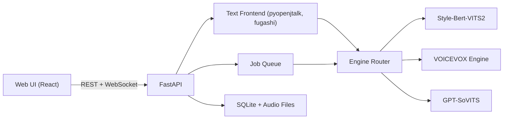
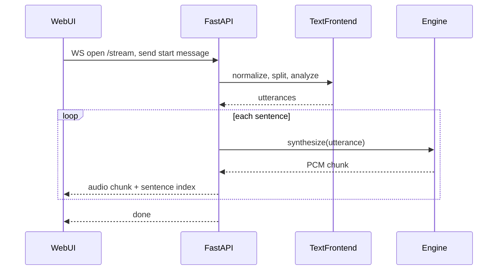
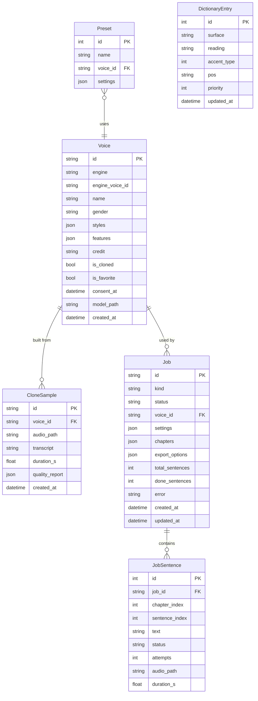
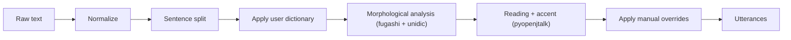

# Japanese TTS Web App — Project Specification

| Item | Value |
|---|---|
| Working name | `jp-tts` |
| Version | 0.1 (draft) |
| Date | 2026-10-14 |
| Status | Draft for review |

---

## 1. Overview and Goals

### 1.1 Summary
`jp-tts` is a locally hosted web application that converts Japanese text into natural-sounding speech. It runs entirely on the user's machine using open-source TTS models, and offers multiple voices, prosody and emotion control, pitch-accent and reading correction, voice cloning, low-latency streaming playback, and batch synthesis of long documents.

### 1.2 Target users
- **Content creators** (YouTube / podcast / VTuber / game developers) who need narration or character voices.
- **Japanese learners and teachers** who need accurate readings and pitch accents for study material.
- **Developers** who want a local, scriptable Japanese TTS service behind a clean API.

### 1.3 Goals
1. Natural, high-quality Japanese speech with correct readings for common text.
2. Full user control over how text is read: readings (kana), pitch accent, speed, pitch, and emotion.
3. Fully local and private: no text or audio leaves the machine.
4. A pluggable engine layer so new open-source models can be added without UI changes.
5. Good UX for both short interactive snippets and book-length documents.

### 1.4 Non-goals (v1)
- Cloud TTS APIs (Google, Azure, Polly, ElevenLabs).
- Mobile apps or native desktop packaging.
- Multi-user accounts, authentication, or multi-tenant hosting.
- Training base models from scratch (fine-tuning for cloning is in scope).
- Languages other than Japanese (English words embedded in Japanese text are handled by transliteration only).

---

## 2. Functional Requirements

Each requirement has an ID (`FR-x.y`) and acceptance criteria (AC).

### 2.1 Basic synthesis
- **FR-1.1** User enters Japanese text (kanji, kana, mixed with ASCII) in the editor and clicks "Generate" to hear it.
- **FR-1.2** Interactive requests accept up to **500 characters**; longer input is redirected to the long-text job flow (2.7).
- **FR-1.3** Output formats: WAV (24/44.1 kHz, 16-bit) and MP3 (192 kbps). Downloadable from the editor.
- **FR-1.4** A history panel keeps the last 50 generations (text, voice, settings, audio) for replay and re-download.

**AC**
- Entering `今日はいい天気ですね。` with the default voice produces playable audio within 2 s on the reference GPU.
- Downloaded WAV and MP3 files play in standard players.
- Input over 500 characters shows a prompt to create a long-text job instead of failing.

### 2.2 Multiple voices
- **FR-2.1** A voice catalog lists every voice from all enabled engines, with name, engine, gender, age range, available styles, license/credit, and a preview clip.
- **FR-2.2** Filter by engine, gender, style/emotion support, and "cloned by me".
- **FR-2.3** Users can mark favorites; favorites appear first in the editor voice picker.
- **FR-2.4** Voices whose engine is offline are shown as unavailable rather than hidden.

**AC**
- Catalog shows voices from at least two engines (Style-Bert-VITS2 and VOICEVOX) at M1.
- Each voice preview plays a fixed sample sentence.
- Required credit text (e.g. VOICEVOX character credits) is displayed on the voice card and included in export metadata.

### 2.3 Prosody and emotion controls
- **FR-3.1** Global controls per generation:
  - Speed: 0.5x – 2.0x (default 1.0)
  - Pitch shift: −12 to +12 semitones (or engine-native range, normalized in UI)
  - Volume: 0.0 – 2.0 (default 1.0)
  - Intonation strength: 0.0 – 2.0 (default 1.0)
  - Pause length scale between sentences: 0.0 – 3.0
- **FR-3.2** Emotion / style selector (e.g. neutral, happy, sad, angry, surprised, whisper) with **intensity** 0–100%, limited to styles the chosen voice supports.
- **FR-3.3** Per-sentence overrides: the user can select a sentence and change speed, pitch, or style for that sentence only.
- **FR-3.4** Presets: save and load named combinations of voice + settings.

**AC**
- Controls the selected engine does not support are disabled with a tooltip explaining why.
- Changing speed to 1.5x produces audio about 1/1.5 the duration (±10%).
- A per-sentence style override affects only that sentence in the output.

### 2.4 Pitch accent and reading correction
- **FR-4.1** "Analyze" shows the text split into accent phrases, each with its reading in katakana and its accent pattern (high/low per mora, accent nucleus position).
- **FR-4.2** User can edit, inline:
  - the reading of a word (e.g. `辛い` → `カライ` vs `ツライ`),
  - the accent nucleus position of a phrase,
  - phrase boundaries (merge/split),
  - pause insertion between phrases.
- **FR-4.3** Edits can be applied **once** (this generation only) or **saved to the user dictionary**.
- **FR-4.4** User dictionary page: add/edit/delete entries (surface form, reading, accent type, part of speech, priority); import/export as CSV/JSON.
- **FR-4.5** Dictionary entries are applied automatically on every analysis and synthesis.
- **FR-4.6** Furigana preview mode: render text with ruby annotations showing the readings the engine will use.

**AC**
- Changing a reading and regenerating produces audio with the new reading.
- A saved dictionary entry is applied to new text containing that word without further edits.
- Accent edits are honored by engines that accept phoneme/accent input (VOICEVOX, Style-Bert-VITS2); for engines that do not, the UI shows a warning.

### 2.5 Voice cloning
- **FR-5.1** User can upload an audio sample (WAV/MP3/FLAC/M4A) or record directly in the browser.
- **FR-5.2** Quality checks before training: duration (min 5 s, recommended 30–60 s for few-shot), sample rate (≥ 16 kHz), clipping, background noise / SNR estimate, and single-speaker check. Show results and warnings.
- **FR-5.3** User provides (or the app auto-transcribes via Whisper) the transcript of the sample; transcript is editable.
- **FR-5.4** Two cloning modes:
  - **Quick (zero/few-shot):** GPT-SoVITS using the reference audio directly; ready in seconds.
  - **Fine-tune:** short fine-tune run for higher similarity; runs as a background job with progress, pause/cancel, and works on both GPU and CPU.
- **FR-5.5** Mandatory consent step: user confirms they own the voice or have explicit permission from the speaker. Consent is stored with the voice record.
- **FR-5.6** Cloned voices appear in the catalog under "cloned by me", can be renamed, and can be deleted (deleting removes the sample and model files).

**AC**
- A clean 30 s sample produces a usable cloned voice in Quick mode in under 60 s on the reference GPU.
- Cloning cannot proceed without the consent checkbox.
- A fine-tune job on a 60 s sample completes in under 30 min on the reference GPU and produces a voice with higher similarity than Quick mode in listening checks.
- Deleting a cloned voice removes all associated files from disk.

### 2.6 Streaming / low-latency output
- **FR-6.1** In streaming mode, text is split into sentences (on `。！？!?…` and newlines, with a maximum chunk length), and each sentence is synthesized and sent to the browser as soon as it is ready.
- **FR-6.2** The browser starts playback when the first chunk arrives and plays chunks gaplessly.
- **FR-6.3** User can stop playback; the server cancels remaining synthesis.
- **FR-6.4** The editor highlights the sentence currently being spoken.

**AC**
- Time-to-first-audio < **1.0 s** on the reference GPU for a typical first sentence (≤ 40 characters).
- No audible gaps or clicks between chunks under normal load.
- Pressing Stop cancels server-side work within 500 ms.

### 2.7 Long-text synthesis
- **FR-7.1** Input via paste (no length limit up to 1,000,000 characters) or file upload: `.txt` (UTF-8 / Shift_JIS auto-detected), `.epub`, `.md`.
- **FR-7.2** Chapters are detected from headings (EPUB TOC, Markdown headings, or lines like `第一章`); the user can review and adjust splits before starting.
- **FR-7.3** A job runs in the background with progress (sentences done / total, ETA), and can be paused, resumed, or cancelled. Jobs survive a server restart and resume from the last completed sentence.
- **FR-7.4** Export: one combined file or one file per chapter (MP3 or WAV), an M4B audiobook with chapter markers, and an SRT/VTT subtitle file aligned to sentences.
- **FR-7.5** Failed sentences are retried up to 3 times, then listed for the user to fix and re-run individually.

**AC**
- A 100,000-character novel completes without manual intervention and produces per-chapter files.
- Killing and restarting the server mid-job resumes without re-synthesizing completed sentences.
- Subtitle timestamps are within ±200 ms of the audio.
- The M4B file opens in common audiobook players (Apple Books, VLC) with working chapter navigation.

---

## 3. Non-Functional Requirements

### 3.1 Performance
| Metric | Target (reference GPU) | Target (CPU fallback) |
|---|---|---|
| Real-time factor (synthesis time / audio time) | < 0.3 | < 1.5 |
| Time-to-first-audio (streaming) | < 1.0 s | < 3.0 s |
| `/analyze` latency for 500 chars | < 200 ms | < 500 ms |
| Editor initial load | < 2 s | < 2 s |

### 3.2 Hardware
- **Reference GPU:** NVIDIA RTX 3060 12 GB (CUDA 12.x).
- **Minimum:** 4-core CPU, 16 GB RAM, 20 GB free disk for models; no GPU. Every feature, including cloning fine-tune, must work in CPU mode at reduced speed. The UI shows an estimated duration before starting slow CPU operations (fine-tune, long-text jobs).
- **OS:** Windows 10/11, Ubuntu 22.04+, macOS 13+ (CPU / MPS best-effort).

### 3.3 Privacy and security
- All processing is local; no telemetry. Network is used only to download models on first run.
- The server binds to `127.0.0.1` by default; binding to other interfaces requires an explicit config flag and shows a warning.
- Uploaded samples and generated audio are stored only in the local `data/` directory.

### 3.4 Reliability
- Engine processes are isolated; a crash in one engine does not take down the API, and the engine is restarted automatically.
- Long-text jobs are checkpointed after every sentence.

### 3.5 Observability
- Structured JSON logs (request id, engine, voice, durations).
- `/health` endpoint reporting status of each engine and the GPU.
- Simple metrics page in the UI: queue length, recent RTF, GPU memory.

### 3.6 Accessibility and i18n
- UI available in Japanese and English.
- Keyboard shortcuts for generate (Ctrl+Enter), play/stop (Space when not editing), and analyze (Ctrl+Shift+A).
- WCAG 2.1 AA color contrast.

---

## 4. System Architecture

### 4.1 Component diagram



### 4.2 Components
| Component | Responsibility |
|---|---|
| **Web UI** | Editor, voice catalog, cloning wizard, jobs, dictionary. Streaming playback via Web Audio API. |
| **FastAPI server** | REST + WebSocket API, validation, orchestration, serving audio files. |
| **Text frontend** | Normalization, sentence splitting, morphological analysis, reading and accent estimation, dictionary application. Produces an engine-neutral `Utterance` structure. |
| **Engine router** | Maps a voice id to its engine adapter, checks feature support, manages engine lifecycles and GPU memory. |
| **Engine adapters** | One per engine; translate `Utterance` + settings into engine-specific calls. |
| **Job queue** | Runs long-text synthesis and cloning fine-tune jobs with checkpoints. v1: in-process `asyncio` worker with SQLite-backed state; later: arq on Redis. |
| **Store** | SQLite (metadata) + filesystem (audio, samples, cloned models). |

### 4.3 Engines
| Engine | Role | Integration | Features |
|---|---|---|---|
| **Style-Bert-VITS2** | Primary, highest quality Japanese | In-process Python library (or its bundled API server) | Styles/emotion with intensity, speed, pitch, accent via phoneme+tone input |
| **VOICEVOX Engine** | Large catalog of ready-made voices | Separate process, HTTP API (`/audio_query`, `/synthesis`) | Speed, pitch, intonation, volume, full accent-phrase editing |
| **GPT-SoVITS** | Voice cloning | Separate process, HTTP API | Zero/few-shot cloning from reference audio, fine-tuning |

### 4.4 `TTSEngine` interface

```python
class Feature(str, Enum):
    STYLE = "style"
    ACCENT_EDIT = "accent_edit"
    PITCH = "pitch"
    SPEED = "speed"
    INTONATION = "intonation"
    STREAMING = "streaming"
    CLONING = "cloning"

class TTSEngine(Protocol):
    id: str

    async def start(self) -> None: ...
    async def stop(self) -> None: ...
    async def health(self) -> EngineHealth: ...

    async def list_voices(self) -> list[VoiceInfo]: ...
    def supports(self, feature: Feature) -> bool: ...

    async def synthesize(
        self, utterance: Utterance, voice_id: str, settings: SynthesisSettings
    ) -> AudioChunk: ...

    def synthesize_stream(
        self, utterances: list[Utterance], voice_id: str, settings: SynthesisSettings
    ) -> AsyncIterator[AudioChunk]: ...
```

`Utterance` holds the original text plus a list of `AccentPhrase` objects (`moras`, `accent_position`, `pause_after_ms`). `AudioChunk` holds PCM samples, sample rate, and the index of the sentence it belongs to.

### 4.5 Request flow (streaming)



---

## 5. API Specification

Base URL: `http://127.0.0.1:8000/api/v1`. JSON request/response unless noted. Errors use `{ "error": { "code": "...", "message": "..." } }`.

### 5.1 Voices
| Method | Path | Description |
|---|---|---|
| GET | `/voices` | List voices. Query: `engine`, `gender`, `style`, `cloned`. |
| GET | `/voices/{id}` | Voice details (styles, supported features, credit). |
| GET | `/voices/{id}/preview` | Preview audio (audio/mpeg). |
| PATCH | `/voices/{id}` | Rename / favorite (cloned voices: rename allowed). |
| DELETE | `/voices/{id}` | Delete a cloned voice and its files. |

### 5.2 Analysis and synthesis
| Method | Path | Description |
|---|---|---|
| POST | `/analyze` | Body: `{ text, voice_id? }`. Returns sentences with accent phrases, readings, accent positions. |
| POST | `/synthesize` | Body: `{ text? , utterances?, voice_id, settings, format }`. Returns audio (`audio/wav` or `audio/mpeg`). Max 500 chars. |

`settings` example:

```json
{
  "speed": 1.0,
  "pitch": 0,
  "volume": 1.0,
  "intonation": 1.0,
  "pause_scale": 1.0,
  "style": "happy",
  "style_intensity": 0.7
}
```

### 5.3 Streaming (WebSocket `/stream`)
Client → server:

```json
{ "type": "start", "text": "...", "voice_id": "sbv2:amitaro", "settings": { } }
{ "type": "stop" }
```

Server → client:

```json
{ "type": "sentence", "index": 0, "text": "今日はいい天気ですね。" }
```

followed by a **binary frame**: 4-byte little-endian sentence index + 16-bit PCM mono at the announced sample rate, then

```json
{ "type": "done" }
{ "type": "error", "code": "ENGINE_UNAVAILABLE", "message": "..." }
```

The first server message is `{ "type": "format", "sample_rate": 44100, "channels": 1, "encoding": "pcm_s16le" }`.

### 5.4 Dictionary
| Method | Path | Description |
|---|---|---|
| GET | `/dictionary` | List entries (paged, searchable). |
| POST | `/dictionary` | Create entry `{ surface, reading, accent_type, pos, priority }`. |
| PUT | `/dictionary/{id}` | Update entry. |
| DELETE | `/dictionary/{id}` | Delete entry. |
| POST | `/dictionary/import` | Upload CSV/JSON. |
| GET | `/dictionary/export` | Download CSV/JSON. |

### 5.5 Cloning
| Method | Path | Description |
|---|---|---|
| POST | `/clone/samples` | Upload sample (multipart). Returns quality report + auto transcript. |
| POST | `/clone` | Body: `{ sample_id, name, transcript, mode: "quick"\|"finetune", consent: true }`. Returns voice id (quick) or job id (finetune). |

### 5.6 Jobs
| Method | Path | Description |
|---|---|---|
| POST | `/jobs` | Create long-text job (multipart file or JSON text) with voice, settings, chapter splits, export options. |
| GET | `/jobs` | List jobs. |
| GET | `/jobs/{id}` | Status, progress, ETA, failed sentences. |
| POST | `/jobs/{id}/pause` \| `/resume` \| `/cancel` | Control. |
| POST | `/jobs/{id}/retry` | Re-run failed sentences. |
| GET | `/jobs/{id}/outputs` | List output files; download via `/files/{path}`. |

### 5.7 OpenAI-compatible endpoint
For drop-in use with existing OpenAI SDK clients, the server also exposes `POST /v1/audio/speech` (outside the `/api/v1` prefix):

```json
{
  "model": "jp-tts",
  "input": "今日はいい天気ですね。",
  "voice": "sbv2:amitaro",
  "response_format": "mp3",
  "speed": 1.0
}
```

- `voice` accepts any jp-tts voice id; OpenAI voice names (`alloy`, `nova`, ...) map to configurable default voices.
- `response_format`: `mp3`, `wav`, `opus`, `flac`, `pcm`.
- Extra jp-tts settings (`style`, `style_intensity`, `pitch`, ...) are accepted as optional fields and ignored by standard clients.
- Returns audio bytes; with `stream: true`, returns chunked audio.

### 5.8 System
| Method | Path | Description |
|---|---|---|
| GET | `/health` | API, engines, GPU status. |
| GET | `/metrics` | Queue length, recent RTF, GPU memory. |

---

## 6. Data Model (SQLite)



`Job.status`: `queued | running | paused | completed | failed | cancelled`. `Job.kind`: `long_text | clone_finetune`.

---

## 7. UI and UX

### 7.1 Pages
| Page | Purpose |
|---|---|
| **Editor** (home) | Type text, pick voice and settings, generate or stream, edit accents and readings. |
| **Voices** | Browse, filter, preview, and favorite voices. |
| **Clone** | Step-by-step wizard: upload/record, quality check, transcript, consent, create. |
| **Jobs** | Create long-text jobs, monitor progress, download outputs. |
| **Dictionary** | Manage user dictionary entries, import/export. |
| **Settings** | Engines on/off, model paths, GPU/CPU, language, bind address. |

### 7.2 Editor layout (wireframe description)
- **Top bar:** voice picker (favorites first), style dropdown + intensity slider, preset menu.
- **Left (main):** text area. Toggle between **Text** mode and **Accent** mode.
  - In Accent mode, each accent phrase is a chip showing katakana above the text and a high/low pitch line drawn over the moras. Clicking a mora moves the accent nucleus; clicking the reading edits it; drag between chips to merge/split; a "+pause" handle sits between chips.
  - Each edited chip has "Apply once" / "Save to dictionary" actions.
- **Right panel:** sliders for speed, pitch, volume, intonation, pause scale; per-sentence override controls when a sentence is selected.
- **Bottom bar:** Generate, Stream, Stop, waveform with playhead, download (WAV/MP3), history drawer.
- During streaming, the sentence being spoken is highlighted in the text area.

### 7.3 Clone wizard steps
1. Upload or record sample.
2. Quality report (green / yellow / red per check) with advice.
3. Review/edit transcript (Whisper auto-transcription).
4. Consent checkbox and voice name.
5. Create; then test the voice with a sample sentence.

---

## 8. Text Processing Pipeline



1. **Normalize**
   - Unicode NFKC for width normalization (full-width ASCII → half-width where appropriate, half-width kana → full-width).
   - Numbers: `1,234` → `千二百三十四`, with counters handled (`3人` → `さんにん`, `1本` → `いっぽん`).
   - Dates and times: `2026/10/14` → `二千二十六年十月十四日`, `18:44` → `十八時四十四分`.
   - Symbols and units: `%`, `℃`, `km`, `¥`, `〜` → spoken forms.
   - URLs and emails: read out or skipped (configurable).
   - English words → katakana via a dictionary (e.g. `alkana`-style table), falling back to letter-by-letter reading.
2. **Sentence split** on `。！？!?…` and newlines; sentences longer than 120 characters are split further on `、` and clause boundaries.
3. **Apply user dictionary** by registering entries with pyopenjtalk's user dictionary so they take part in analysis.
4. **Morphological analysis** to resolve readings of ambiguous words and detect proper nouns.
5. **Reading + accent** with pyopenjtalk (`run_frontend`, `make_label`) producing accent phrases, moras, and accent nucleus positions.
6. **Manual overrides** from the editor (Accent mode) are merged in last and take priority.

The output `Utterance` is engine-neutral. Adapters convert it to VOICEVOX `AudioQuery` accent phrases or Style-Bert-VITS2 phoneme/tone sequences.

---

## 9. Licensing and Ethics

### 9.1 Third-party licenses
| Component | License | Implication |
|---|---|---|
| Style-Bert-VITS2 | AGPL-3.0 | If the app is distributed or offered as a network service, source must be made available under AGPL. Keep it as a separate process/module and document this. Individual model weights have their own terms. |
| VOICEVOX Engine | LGPL-3.0 (engine); per-character terms (voices) | Each character voice requires specific credit text (e.g. `VOICEVOX:ずんだもん`) and has its own usage rules; display and embed credits. |
| GPT-SoVITS | MIT | Permissive; pretrained weights may carry separate terms. |
| pyopenjtalk / OpenJTalk | MIT / Modified BSD | Permissive. |
| fugashi / unidic | MIT / BSD-style | Permissive. |
| Whisper (cloning transcripts) | MIT | Permissive. |

**Project license:** AGPL-3.0 for the whole project, compatible with Style-Bert-VITS2. Anyone offering the app as a network service must provide its source.

### 9.2 Ethics and responsible use
- Voice cloning requires an explicit consent confirmation, stored with a timestamp.
- The UI and README state that cloning a person's voice without permission, impersonation, and fraud are prohibited.
- Exported files include metadata tags (`comment`/`TXXX`) noting the audio is synthetic and naming the voice and engine.
- Optional (later): inaudible watermarking of generated audio.

---

## 10. Project Structure and Tech Stack

### 10.1 Tech stack
| Layer | Choice |
|---|---|
| Backend | Python 3.11, FastAPI, Uvicorn, Pydantic v2, SQLModel (SQLite), `soundfile`, `pydub`/ffmpeg |
| Text frontend | pyopenjtalk, fugashi, unidic, custom normalizer |
| Engines | Style-Bert-VITS2, VOICEVOX Engine, GPT-SoVITS; PyTorch with CUDA 12.x |
| Transcription | faster-whisper |
| Frontend | React 18, TypeScript, Vite, TanStack Query, Zustand, Tailwind CSS, Web Audio API (AudioWorklet) |
| Packaging | Docker Compose (GPU via NVIDIA Container Toolkit) and a non-Docker `uv`/`pnpm` dev setup |
| Testing | pytest, pytest-asyncio, Vitest, Playwright |
| Tooling | ruff, mypy, ESLint, Prettier, pre-commit |

### 10.2 Repository layout

```
jp-tts/
  SPEC.md
  README.md
  docker-compose.yml
  backend/
    pyproject.toml
    app/
      main.py
      api/            # routers: voices, synth, stream, dictionary, clone, jobs, system
      core/           # config, logging, db
      text/           # normalizer, splitter, analyzer, dictionary
      engines/
        base.py       # TTSEngine protocol, Feature, VoiceInfo
        router.py
        sbv2.py
        voicevox.py
        gpt_sovits.py
      jobs/           # queue, workers, exporters (mp3, m4b, srt)
      models/         # SQLModel tables
    tests/
  frontend/
    package.json
    src/
      pages/          # Editor, Voices, Clone, Jobs, Dictionary, Settings
      components/     # AccentChip, VoicePicker, Waveform, ...
      audio/          # streaming player (AudioWorklet)
      api/            # typed client
  models/             # downloaded model weights (gitignored)
  data/               # sqlite db, audio outputs, clone samples (gitignored)
  scripts/            # model download, benchmarks
```

---

## 11. Milestones

| Milestone | Scope | Exit criteria |
|---|---|---|
| **M1 — Foundation** | Repo skeleton, FastAPI, SQLite, text frontend (normalize, split, pyopenjtalk), Style-Bert-VITS2 and VOICEVOX adapters, `/synthesize`, `/voices`, Editor page with generate/download, Voices page. | FR-1.x and FR-2.x ACs pass. |
| **M2 — Control and streaming** | Prosody sliders, style/emotion with intensity, presets, per-sentence overrides, WebSocket streaming with gapless player and highlighting, OpenAI-compatible `/v1/audio/speech`. | FR-3.x and FR-6.x ACs pass; latency targets met; OpenAI Python SDK can generate speech against the server. |
| **M3 — Accent and readings** | `/analyze`, Accent mode editor, furigana preview, user dictionary CRUD and import/export. | FR-4.x ACs pass; reading-accuracy test set ≥ 97%. |
| **M4 — Long text** | Job queue with checkpoints, file upload (txt/epub/md), chapter detection, exports (MP3/WAV/M4B/SRT), retry flow. | FR-7.x ACs pass. |
| **M5 — Voice cloning** | GPT-SoVITS adapter, sample upload/record, quality checks, Whisper transcription, consent, quick mode and fine-tune mode. | FR-5.x ACs pass. |
| **M6 — Hardening** | Docker Compose, CPU-mode verification of every feature, i18n, accessibility pass, docs. | Clean install on Windows and Ubuntu from README; all FR ACs pass in CPU mode (performance targets excepted). |

---

## 12. Testing and Evaluation

- **Unit tests (backend):** normalizer (numbers, dates, counters, units, English), sentence splitter, dictionary application, `Utterance` → engine conversion.
- **Reading-accuracy test set:** about 500 curated sentences with gold readings and accents (homographs like `辛い`, `今日`, `生`, proper nouns, numbers with counters). Track accuracy per release; target ≥ 97% mora-level reading accuracy.
- **Engine contract tests:** every adapter runs the same suite (list voices, synthesize, stream, feature flags), using mocks in CI and real engines in a GPU job.
- **API tests:** pytest + httpx for all endpoints, including the WebSocket protocol.
- **Frontend:** Vitest for components and the streaming player; Playwright end-to-end tests for generate, stream, accent edit, job, and clone flows.
- **Quality evaluation:** periodic MOS-style listening checks (5-point naturalness and similarity for clones) by at least 3 listeners on a fixed sentence set; optionally an automatic MOS predictor (e.g. UTMOS) for regressions.
- **Performance benchmarks:** `scripts/bench.py` measuring RTF, time-to-first-audio, and `/analyze` latency on the reference GPU and CPU.

---

## 13. Risks and Open Questions

### 13.1 Risks
| Risk | Impact | Mitigation |
|---|---|---|
| AGPL obligations from Style-Bert-VITS2 | Source must be shared when served over a network | Project is licensed AGPL-3.0; documented in README. |
| CPU-mode fine-tune and long jobs are very slow | Poor UX on machines without a GPU | Show duration estimates up front, checkpoint and resume, allow pausing. |
| GPU memory pressure with three engines loaded | OOM, slow switching | Engine router loads models lazily and unloads least-recently-used; configurable max resident engines. |
| Reading errors on rare words / proper nouns | Wrong pronunciation | User dictionary, Accent mode, curated base dictionary, test set. |
| Accent edits not supported uniformly across engines | Inconsistent UX | Feature flags per engine; UI disables unsupported controls with explanation. |
| Gaps/clicks in streaming playback | Poor UX | AudioWorklet ring buffer, short crossfades, prefetch next sentence. |
| Voice cloning misuse | Legal / ethical harm | Consent step, synthetic-audio metadata, clear usage policy. |
| Windows setup complexity (CUDA, ffmpeg, MeCab) | Adoption friction | Docker Compose, setup script, bundled ffmpeg check. |

### 13.2 Resolved decisions
- License: AGPL-3.0 for the whole project.
- Fine-tune cloning: included in v1.
- CPU mode: every feature must work without a GPU.
- OpenAI-compatible `/v1/audio/speech`: included (M2).
- M4B audiobook export: required (M4).

### 13.3 Open questions
1. Which specific default voices / Style-Bert-VITS2 models ship (or are downloaded) on first run?
